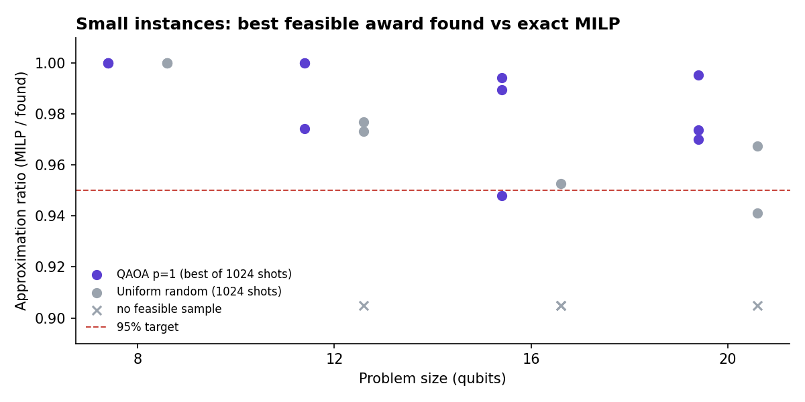
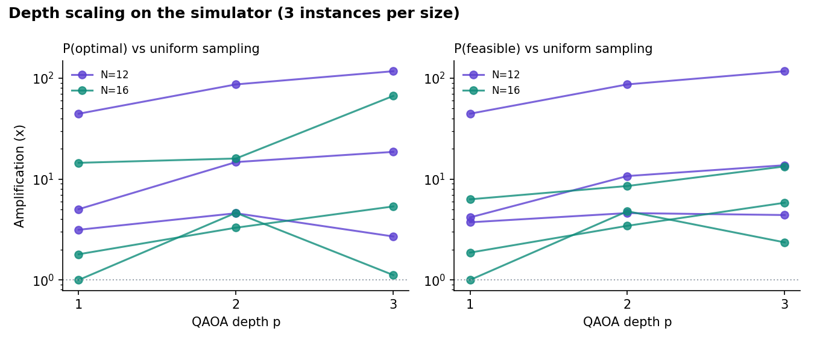
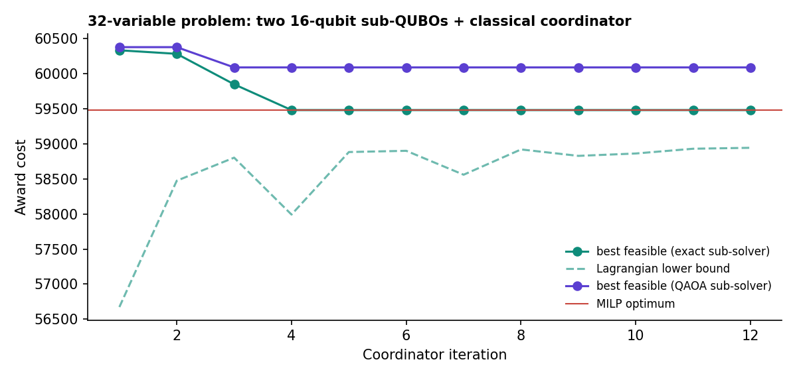

# Q-Allocate: hybrid quantum-classical QUBO solver for supplier split-awards

Q-Allocate frames **risk-adjusted supplier split-award selection** as a QUBO and solves it with a **QAOA hybrid loop**. A SciPy optimiser updates the circuit angles, and a quantum simulator (Qiskit Aer or Amazon Braket) evaluates the circuit. Every result is benchmarked against an **exact MILP optimum** on the same instance.

This repository is the code and evidence for a capstone project carried out under the QpiAI execution guidelines. The guidelines cover hardware mapping, encoding, simulator-based testing on Google Colab, and five success criteria. Everything here runs on a laptop or the Colab free tier.

> **Data.** All instances are synthetic and generated from a seed (`qallocate/instance.py`). No company or supplier data is included.
> **Hardware.** All results in this repository come from simulators. No QPU (including QpiAI-Indus) results are reported here.



## Success criteria: status

Measured on the synthetic instances in `results/`. Regenerate everything with the scripts below.

| # | Criterion (from the execution guidelines) | Result | Evidence |
| --- | --- | --- | --- |
| 1 | **Mathematical validity:** constraints mapped to an Ising Hamiltonian without violating problem bounds | ✅ For all 12 small instances, the QUBO ground state is feasible and equals the MILP optimum. The Ising diagonal matches the QUBO energy on every basis state. MOQ holds by construction for every bitstring. | `tests/test_core.py`, `results/small_benchmark.json` |
| 2 | **Classical baseline:** exact MILP optimum and latency | ✅ PuLP/CBC solves every instance exactly: about 6 ms for N ≤ 20 and **80 ms for the 32-variable instance**. *The proposal's projected 14.82 s is not reproduced on these instances (see notes).* | `scripts/01`, `scripts/04` |
| 3 | **Hybrid execution:** classical optimiser updates (γ, β) and converges | ✅ COBYLA drives 171 (p=1) and 150 (p=2) circuit evaluations on **Qiskit AerSimulator** and converges. The best sample is optimal. | `scripts/03_aer_hybrid_loop.py`, `docs/images/aer_convergence.png` |
| 4 | **Approximation ratio ≥ 95%** for N ≤ 20 | ✅ Mostly met: **11 of 12** instances reach ≥ 95% with raw QAOA p=1 (mean **98.7%**, minimum 94.8% at N=16). With classical local search on the samples, all 12 reach ≥ 99.5%. | `results/small_benchmark.json` |
| 5 | **Scaling and decomposition:** 32-variable problem via cloud simulator or decomposition | ✅ Lagrangian decomposition into two **16-qubit sub-QUBOs** solved by QAOA reaches **98.99%** of the MILP optimum on the capacity-coupled 32-variable problem (exact sub-solvers: 100%). A Braket SV1 script for the monolithic 32-qubit circuit is included and tested on the local simulator. | `scripts/04`, `scripts/05`, `docs/images/decomposition_32.png` |

## The model

For category *i* and supplier *v*, the award is a whole number of lots:

$$q_{iv} = \text{lot}_{iv} \sum_{b=0}^{B-1} 2^b x_{ivb}, \qquad x_{ivb}\in\{0,1\}$$

* **Binary encoding** (guideline 2.1): *B* bits per category-supplier pair instead of one-hot quantity bands, so the qubit count grows with log of the largest award.
* **MOQ by construction:** the lot size is the supplier's MOQ, so any non-zero award is at least the MOQ. No penalty term is needed.
* **Split-award cap:** *B* bits cap a supplier at (2<sup>B</sup> − 1) lots in a category.

Objective (guideline equation 1), with $c_{iv} = P_{iv} + T_{iv} + L_{iv} + \alpha R_{iv}$:

$$\min \sum_{i,v} c_{iv}\, q_{iv} \;+\; P_{\text{penalty}} \sum_i \Big(\sum_v q_{iv} - D_i\Big)^2$$

* **Dynamic penalty** (guideline 2.2): start at $P_{\text{penalty}} = \max P_{iv}$ and double it whenever the lowest-energy sampled bitstring violates demand (`qallocate/penalty.py`).
* **Ising mapping:** $x_j = (1 - Z_j)/2$ gives $H_C = \sum J_{jk} Z_j Z_k + \sum h_j Z_j$ (`qallocate/ising.py`).
* **QAOA:** p = 1 as the hardware target, with p = 2 and 3 charted on the simulator (guideline 2.3). The angles minimise **CVaR<sub>0.1</sub>** of the normalised cost, and p+1 is warm-started from p (INTERP).
* **Supplier capacity** couples categories in the 32-variable problem. It is handled by **Lagrangian decomposition**: a classical coordinator prices capacity, QAOA solves each category block, and a primal-recovery pass stitches capacity-feasible awards (`qallocate/decomposition.py`).

The full derivation is in [docs/formulation.md](docs/formulation.md).

## Results

| Size | Instances | QAOA p=1 ratio (mean / min) | Random sampling found a feasible award | P(feasible) gain vs uniform | MILP time | QAOA simulation time |
| --- | --- | --- | --- | --- | --- | --- |
| 8 qubits | 3 | 100.0% / 100.0% | 3 of 3 | 2.1× | 6 ms | 0.1 s |
| 12 qubits | 3 | 99.1% / 97.4% | 2 of 3 | 17× | 6 ms | 0.4 s |
| 16 qubits | 3 | 97.7% / 94.8% | 1 of 3 | 3.1× | 7 ms | 3.2 s |
| 20 qubits | 3 | 98.0% / 97.0% | 2 of 3 | 11× | 7 ms | 80 s |
| 32 variables (2 × 16-qubit blocks) | 1 | 98.99% | n/a | n/a | 80 ms | 73 s |





More detail is in [docs/results.md](docs/results.md).

## Honest notes

* **No quantum advantage is claimed.** At these sizes the MILP is exact and takes milliseconds, and simulating QAOA is slower. The value of this repository is a correct, constraint-respecting hybrid pipeline with honest measurement, as the guidelines ask.
* **Random baseline.** QAOA always returned a feasible award; uniform sampling with the same shots failed on 4 of 12 instances. The optimised state raises the probability of sampling a feasible award by 1× to 44× over uniform (median about 3.8×). The gain varies a lot by instance.
* **Local search dominates.** With classical local search applied to the samples, QAOA starts and random starts reach the same quality. Both are reported, never merged.
* **Latency target.** The guidelines quote ~14.82 s for the 32×32 MILP baseline (from the proposal). On these synthetic instances CBC needs 80 ms, so that figure should not be cited as a result.
* **Not yet done:** runs on QpiAI-Indus (25 qubits, p = 1 on ≤ 25-qubit sub-QUBOs), a domain-wall vs binary encoding comparison, and the QML risk layer.

## Repository layout

```
qallocate/            library
  instance.py         synthetic, always-feasible instances (JSON save/load)
  qubo.py             QUBO build, energy, decode, constraint checks, brute force
  ising.py            QUBO -> Ising, Qiskit SparsePauliOp
  classical.py        PuLP/CBC MILP baseline
  qaoa.py             QAOA: Qiskit Aer engine + fast numpy statevector engine, CVaR, INTERP
  penalty.py          dynamic penalty tuning loop
  decomposition.py    Lagrangian decomposition with primal recovery
  postprocess.py      local search on samples (reported separately)
scripts/
  01_small_benchmark.py   criteria 1, 2, 4
  02_depth_scaling.py     p = 1, 2, 3 on the simulator
  03_aer_hybrid_loop.py   criterion 3 on Qiskit AerSimulator
  04_decomposition_32.py  criterion 5 via decomposition
  05_braket_sv1.py        full 32-qubit circuit on Amazon Braket SV1
  06_make_figures.py      figures in docs/images
notebooks/Q_Allocate_Colab.ipynb
tests/test_core.py        QUBO, Ising, MILP, MOQ and engine-equivalence checks
results/                  JSON outputs used in this README
```

## Run it

**Google Colab:** open `notebooks/Q_Allocate_Colab.ipynb` and run all cells.

**Locally (Python 3.10+):**

```bash
pip install -r requirements.txt
pytest -q
python scripts/01_small_benchmark.py --quick     # ~1 s; full run ~5 min
python scripts/02_depth_scaling.py
python scripts/03_aer_hybrid_loop.py
python scripts/04_decomposition_32.py
python scripts/06_make_figures.py
```

**Amazon Braket SV1 (optional, billed):** configure AWS credentials, then run `python scripts/05_braket_sv1.py --device sv1`. Test for free first with `--local --small`.

PuLP is pinned below 3.0 because later versions no longer bundle the CBC solver.

## Author

Senthil Kumar, AI & quantum systems practitioner with 20+ years in global procurement. [LinkedIn](https://www.linkedin.com/in/senthil-kumar-m-34b83a18/)

Capstone guidance from QpiAI. QpiAI product names are used only to describe the project context.

## License

MIT
