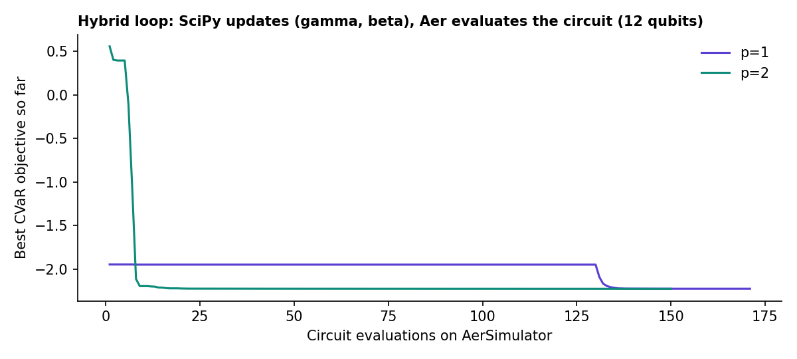

# Results

All results are from simulators on synthetic instances. Reproduce them with the scripts in `scripts/`; the raw numbers are in `results/*.json`.

## Small instances (criteria 1, 2, 4)

QAOA p = 1, CVaR0.1 objective, dynamic penalty, 1,024 shots. The random baseline draws 1,024 uniform bitstrings. *Ratio* = MILP optimum ÷ best feasible award found (1.000 = optimal). Local search (LS) results are shown separately.

| Qubits | Seed | MILP cost | MILP ms | Ground state = MILP | QAOA ratio | Random ratio | QAOA + LS | Random + LS | P(feasible) QAOA / uniform | Penalty rounds |
| --- | --- | --- | --- | --- | --- | --- | --- | --- | --- | --- |
| 8 | 0 | 6,477.0 | 6 | yes | 1.000 | 1.000 | 1.000 | 1.000 | 0.2407 / 0.0625 | 1 |
| 8 | 1 | 10,487.1 | 7 | yes | 1.000 | 1.000 | 1.000 | 1.000 | 0.0247 / 0.0234 | 1 |
| 8 | 2 | 11,171.8 | 5 | yes | 1.000 | 1.000 | 1.000 | 1.000 | 0.1306 / 0.0938 | 1 |
| 12 | 0 | 46,756.9 | 5 | yes | 1.000 | — | 1.000 | 1.000 | 0.0217 / 0.0005 | 1 |
| 12 | 1 | 25,020.8 | 6 | yes | 0.974 | 0.977 | 1.000 | 1.000 | 0.0122 / 0.0029 | 1 |
| 12 | 2 | 47,044.0 | 7 | yes | 1.000 | 0.973 | 1.000 | 1.000 | 0.0182 / 0.0049 | 1 |
| 16 | 0 | 32,657.5 | 8 | yes | 0.948 | — | 1.000 | 1.000 | 0.0005 / 0.0005 | 1 |
| 16 | 1 | 33,514.0 | 5 | yes | 0.989 | — | 1.000 | 1.000 | 0.0077 / 0.0012 | 1 |
| 16 | 2 | 33,631.4 | 8 | yes | 0.994 | 0.953 | 1.000 | 1.000 | 0.0041 / 0.0022 | 1 |
| 20 | 0 | 25,611.8 | 5 | yes | 0.974 | 0.941 | 1.000 | 1.000 | 0.0270 / 0.0015 | 1 |
| 20 | 1 | 48,675.0 | 7 | yes | 0.970 | 0.967 | 1.000 | 1.000 | 0.0028 / 0.0009 | 1 |
| 20 | 2 | 42,513.5 | 8 | yes | 0.995 | — | 0.995 | 0.995 | 0.0023 / 0.0002 | 1 |

A dash means no feasible award appeared among the samples. The lowest-energy sample was feasible at the starting penalty (max Piv) on every instance, so the penalty-doubling step was never triggered.

## Depth scaling (guideline 2.3)

Penalty fixed at max Piv; angles for p+1 warm-started from p.

| Qubits | Seed | p | P(feasible) | P(optimal) ÷ uniform | Best ratio (1,024 shots) | Optimiser evaluations |
| --- | --- | --- | --- | --- | --- | --- |
| 12 | 0 | 1 | 0.0217 | 44.4× | 1.000 | 337 |
| 12 | 0 | 2 | 0.0423 | 86.8× | 1.000 | 300 |
| 12 | 0 | 3 | 0.0572 | 117.2× | 1.000 | 300 |
| 12 | 1 | 1 | 0.0122 | 5.0× | 0.974 | 378 |
| 12 | 1 | 2 | 0.0314 | 14.7× | 1.000 | 138 |
| 12 | 1 | 3 | 0.0402 | 18.6× | 1.000 | 300 |
| 12 | 2 | 1 | 0.0182 | 3.1× | 1.000 | 495 |
| 12 | 2 | 2 | 0.0225 | 4.6× | 1.000 | 300 |
| 12 | 2 | 3 | 0.0215 | 2.7× | 1.000 | 300 |
| 16 | 0 | 1 | 0.0005 | 1.0× | 0.948 | 336 |
| 16 | 0 | 2 | 0.0023 | 4.6× | 0.948 | 300 |
| 16 | 0 | 3 | 0.0012 | 1.1× | 0.948 | 300 |
| 16 | 1 | 1 | 0.0077 | 14.5× | 0.989 | 397 |
| 16 | 1 | 2 | 0.0104 | 16.0× | 0.989 | 300 |
| 16 | 1 | 3 | 0.0163 | 66.7× | 1.000 | 300 |
| 16 | 2 | 1 | 0.0041 | 1.8× | 0.994 | 321 |
| 16 | 2 | 2 | 0.0075 | 3.3× | 0.994 | 300 |
| 16 | 2 | 3 | 0.0127 | 5.4× | 0.994 | 300 |

Deeper circuits usually raise P(feasible) and P(optimal), though not on every instance (for example N=16, seed 0). On NISQ hardware the extra depth would also add noise, which is why p = 1 stays the hardware target.

## Hybrid loop on Qiskit AerSimulator (criterion 3)

* **p = 1:** 171 circuit evaluations in 1.2 s; γ = [1.155], β = [2.337]; best sample ratio 1.000.
* **p = 2:** 150 circuit evaluations in 1.2 s; γ = [0.792, 1.585], β = [2.594, -0.407]; best sample ratio 1.000.

## 32-variable decomposition (criterion 5)

MILP optimum 59,481.4 (80 ms). Without capacity the optimum would be 56,673.9, so capacity is binding.

| Block solver | Sub-QUBO sizes | Best feasible cost | Ratio | Run time |
| --- | --- | --- | --- | --- |
| Exact (reference) | [16, 16] | 59,481.4 | 1.0000 | 0.5 s |
| QAOA p=1 | [16, 16] | 60,089.3 | 0.9899 | 72.8 s |

